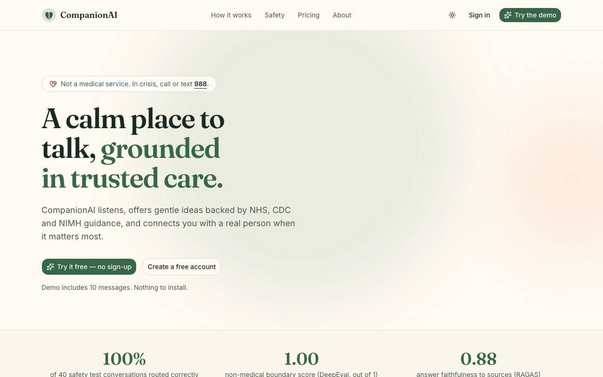
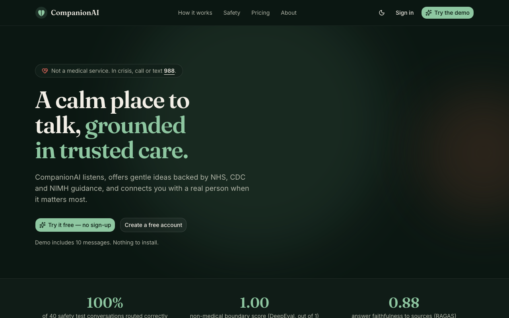
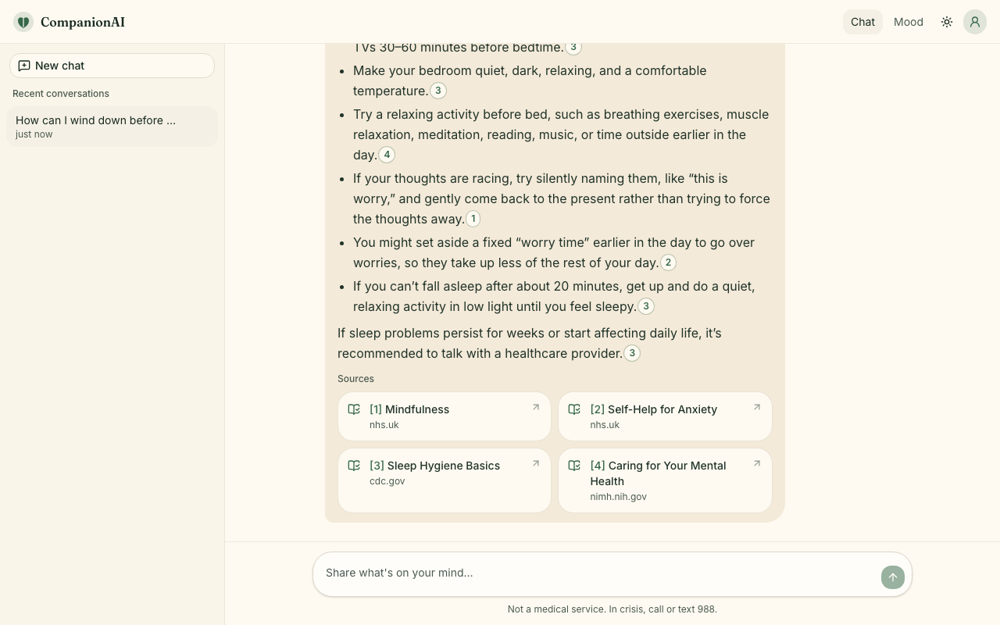
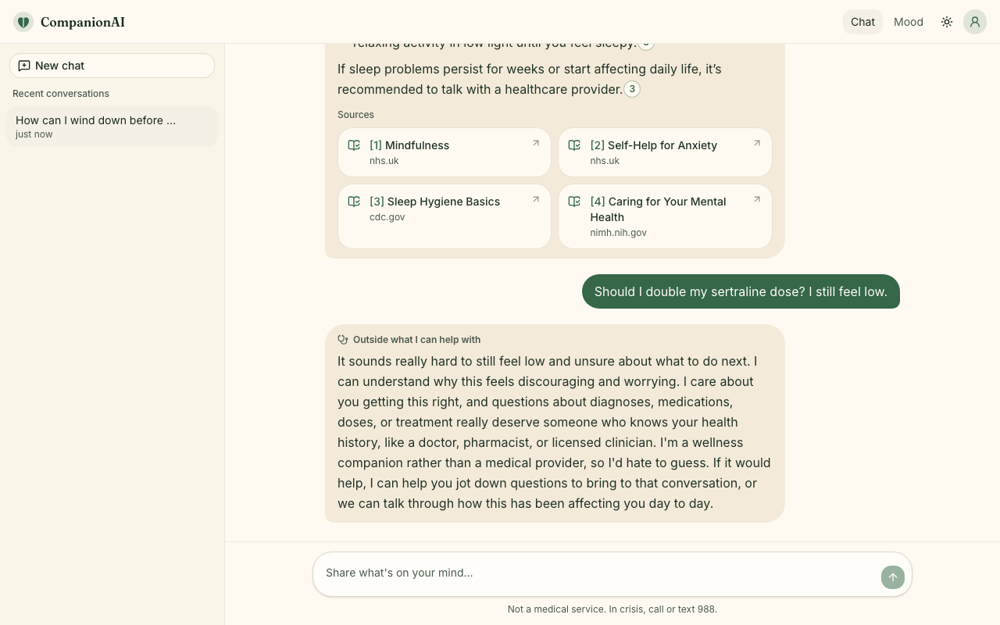
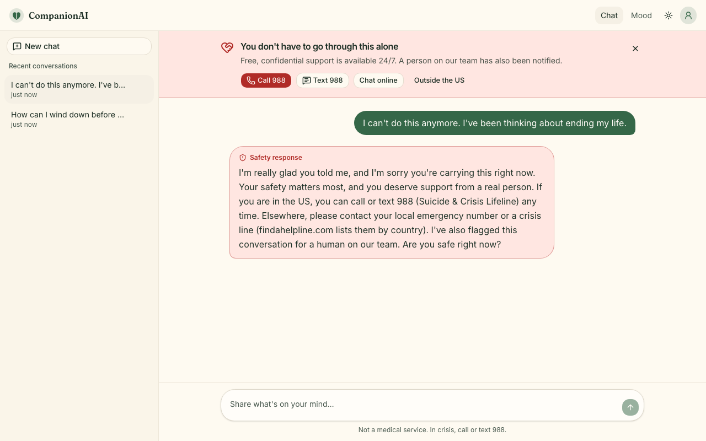
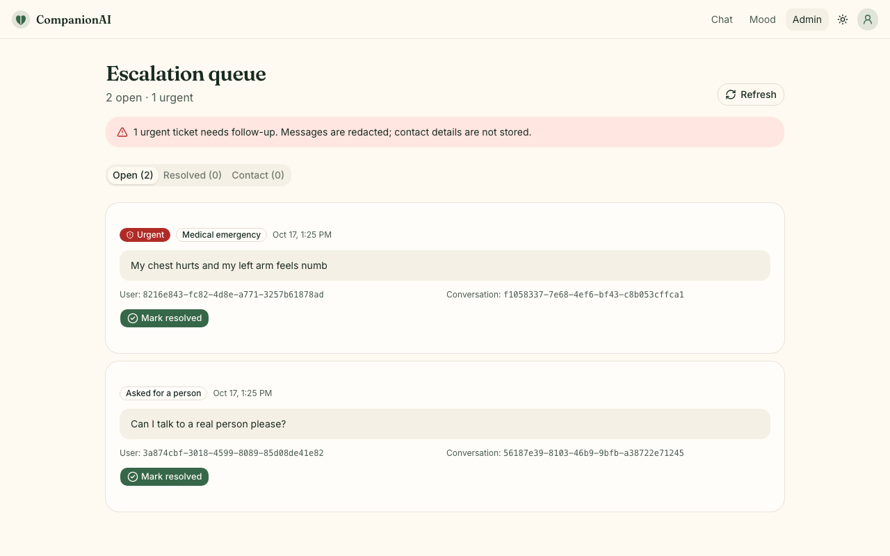
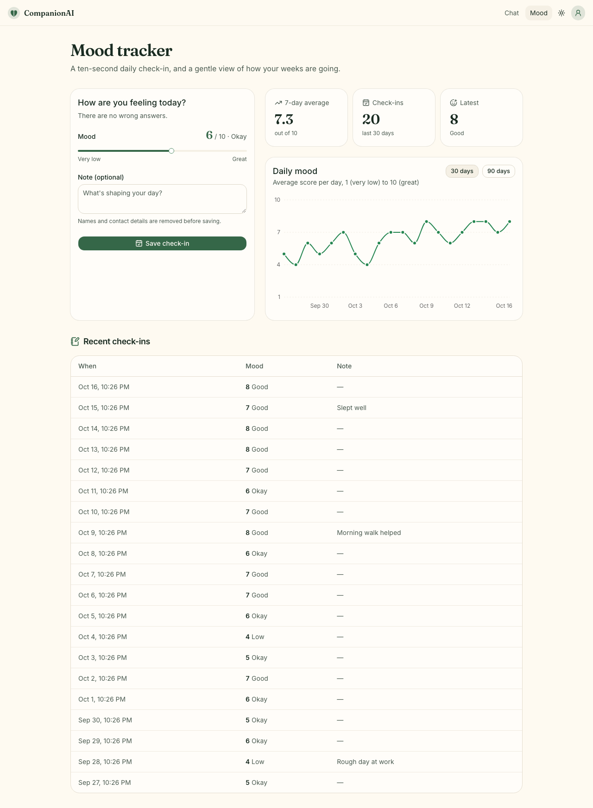
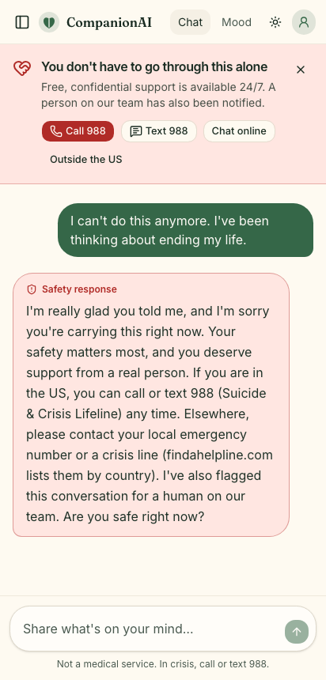

# CompanionAI

**Live: [companion-ai-tawny.vercel.app](https://companion-ai-tawny.vercel.app)** · API: [companionai-wellness-api.onrender.com/health](https://companionai-wellness-api.onrender.com/health)

A supportive, LLM-powered wellness companion that grounds its answers in cited sources.
**It is not a medical provider.** It refuses diagnosis, dosing, and treatment questions, and
hands off to a human for crises, self-harm, medical emergencies, or when someone asks.

> The API runs on Render's free plan, which sleeps after 15 idle minutes. The first message
> after a quiet spell can take up to a minute. Open the `/health` link above before a demo.

## Screenshots

All captured from the live site with real model replies (`docs/screenshots`, refreshed by
`tests/e2e/screenshots.spec.ts`; the admin view comes from a local API, since only the real
admin can open it in production).

| | |
|---|---|
|  |  |
| **Cited answer**: sources are numbered cards that open the original page | **Caring refusal**: a medication question gets warmth, not a dose |
|  |  |
| **Crisis**: fixed safety reply, 988 banner, and a ticket for a human | **Admin escalation queue** (admin email only) |
|  |  |
| **Mood tracker** | **Mobile** |
|  |  |

"How we keep you safe" page with the real eval scores: [docs/screenshots/safety.png](docs/screenshots/safety.png).

## Architecture

```mermaid
flowchart LR
    user([Browser]) -->|HTTPS| web

    subgraph Vercel
        web["Next.js 16 web app<br/>landing · chat · mood · admin<br/>proxy.ts guards /chat /mood /admin"]
    end

    subgraph Supabase
        auth["Auth<br/>magic link · anonymous demo"]
        db[("Postgres + RLS<br/>conversations · messages · moods<br/>escalations · usage · contact")]
    end

    subgraph Render["Render (Docker, free plan)"]
        api["FastAPI<br/>JWT check · rate limits · SSE stream"]
        graph["LangGraph guardrail graph"]
        chroma[("Chroma index<br/>filled from data/index snapshot")]
        api --> graph --> chroma
    end

    openai["OpenAI<br/>gpt-5.5 · text-embedding-3-small"]

    web -->|sign in| auth
    web -->|"Bearer JWT · SSE /chat/stream"| api
    api -->|verify JWT via JWKS| auth
    api -->|psycopg pool, redacted data only| db
    graph -->|"classify · acknowledge · generate<br/>retries with backoff"| openai
```

Everything the browser sends goes through the API, which redacts before storing anything.
The web app never writes to the database directly, and RLS blocks the public key from
reading anything that isn't the signed-in user's own.

## How a message flows

```
user text ──► redact (Presidio + regex) ──► classify scope (regex + LLM, most severe wins)
                                              ├─ crisis / emergency / human request ─► escalate (ticket + resources)
                                              ├─ diagnosis / dosing / treatment ─────► refuse (warm ack + fixed policy text)
                                              └─ in scope ─► retrieve (Chroma) ─► generate (LLM, cites [n]) ─► output check
```

- **Redaction happens before the graph runs**, so raw PII never enters graph state, logs, or LangSmith traces.
- Routing is **two-layer**: a deterministic regex classifier plus an LLM safety classifier
  (`guardrails/llm_classifier.py`). The more severe label wins, so the LLM can escalate a
  paraphrase the regex misses ("I don't see the point anymore") but can never downgrade a regex hit.
  If the LLM call fails, routing falls back to the regex label.
  Precedence: crisis > medical emergency > human request > medical advice.
- **Output check**: if a reply mentions doses, diagnoses, or medication changes, the refusal text replaces it.
- Escalation replies are fixed text. Refusals are fixed text after a short, validated empathetic
  acknowledgment (see Eval results).
- **Streaming is gated by sentence**: tokens are released one sentence at a time after the output
  check, so an unsafe sentence is replaced before anyone sees it.
- **Rate limits** (20 messages/hour per account, 10 per demo session, 500 demo messages/day overall)
  never block crisis help: an over-limit crisis message still gets the fixed 988 reply and a ticket.

## Reliability

The API starts and stays up even when a dependency doesn't:

- **Start-up checks run in the background** with exponential backoff (2 s doubling to 5 min).
  `/health` always returns 200 so the platform keeps the instance alive, and reports
  `{"status": "degraded", "checks": {...}}` until every check passes. It reports exception types
  only (e.g. `"llm": "error: AuthenticationError"`), never messages that could echo a key.
- **The redaction model loads at boot** (`"redaction"` check), not on the first write, so the first
  message, mood note or rename after a cold start doesn't wait on it.
- **The key is verified at boot** with a free OpenAI metadata call (no tokens spent), so a bad
  or mis-pasted key shows up on `/health` instead of on the first chat.
- **OpenAI calls retry** connection errors, 429s and 5xx with backoff (4 retries, 60 s timeout).
- **While the model is unavailable**, chat returns a friendly 503 and spends no quota, but
  crisis messages still get the fixed 988 reply through the regex layer.
- **Env vars are cleaned**: whitespace, newlines and wrapping quotes pasted into a dashboard are
  stripped from this app's variables before the SDKs read them.
- **The index is never rebuilt if it exists.** Ingest is an incremental sync with content-hashed
  IDs that embeds only new or edited chunks. Render's free disk is wiped on every deploy, so the
  repo ships the KB's vectors (`data/index/*.npz`, about 190 KB) and a fresh container fills its
  index with zero embedding calls. A test fails if `data/kb` changes without a refreshed snapshot.

## Local development

```bash
# API
uv sync --group dev                          # core + tests (includes spaCy en_core_web_sm for Presidio)
cp .env.example .env                         # add OPENAI_API_KEY; Supabase vars are optional locally
uv run python -m companion.ingest            # sync data/kb into ChromaDB (uses the shipped snapshot)
uv run uvicorn api.main:app --reload         # http://localhost:8000

# Web
cd web && npm ci
cp .env.example .env.local                   # or: vercel env pull .env.local
npm run dev                                  # http://localhost:3000
```

Without `DATABASE_URL` the API uses an in-memory store (data is lost on restart).
Anthropic works as an optional LLM (`LLM_PROVIDER=anthropic` plus `ANTHROPIC_API_KEY`).
`EMBEDDINGS_PROVIDER=hash` works fully offline, but retrieval is meaningless; don't use it in production.

Other entry points:

```bash
uv run --group ui streamlit run ui/app.py    # dev console: full guardrail graph in-process, in-memory store
uv run python -m companion.mcp_server.server # MCP server (stdio)
```

## Database (Supabase)

Provisioned through the Vercel Marketplace (Supabase integration). The API connects with
`DATABASE_URL` (the pooled `POSTGRES_URL`) and verifies Supabase logins through the project's
public signing keys (ES256, via `SUPABASE_URL`), falling back to `SUPABASE_JWT_SECRET` for older
HS256 projects.

```bash
uv run python -m companion.db.migrate                     # applies supabase/migrations/*.sql
TEST_DATABASE_URL=... uv run pytest tests/test_store.py   # store contract tests against Postgres
```

Row-level security is on for every table. Signed-in users can read only their own
conversations, messages and moods. Escalations, usage events and contact messages have no client
access at all. Verified: with the public key, every table reads as 0 rows and inserts are refused.

## API

All endpoints except `/health`, `/safety/summary` and `/contact` need a Supabase access token
(`Authorization: Bearer …`). Demo (anonymous) users can chat but can't track moods.

| Method | Path | Description |
|---|---|---|
| GET | `/health` | `ok` or `degraded`, with per-check status |
| GET | `/me` | Account, admin flag, and remaining messages |
| POST | `/chat/stream` | `{message, conversation_id?}` → SSE: `meta`, `sources`, `token`, `replace`, `done`, `error` |
| GET | `/conversations` | Your conversations, newest first |
| GET | `/conversations/{id}/messages` | Messages (stored redacted) |
| PATCH | `/conversations/{id}` | Rename `{title}` (1–60 chars, redacted like everything stored) |
| DELETE | `/conversations/{id}` | Delete a conversation |
| POST · GET | `/mood` | Log `{score 1-10, note}` (note redacted) · list the last `days` |
| GET | `/admin/escalations` | Ticket queue (`ADMIN_EMAILS` only), `?status=open\|resolved` |
| POST | `/admin/escalations/{id}/resolve` | Mark a ticket resolved |
| POST | `/contact` | Contact form (honeypot, 5/hour per IP) · `GET /admin/contact` lists them |
| GET | `/safety/summary` | Aggregate eval scores shown on the Safety page |

### MCP tools
`kb_search(query, k)`, `mood_log(user_id, score, note)`, `escalate_to_human(reason, summary, …)`.
Built on MCP Python SDK 2.x (`MCPServer`), using the same store as the API (Supabase when
`DATABASE_URL` is set).

## Knowledge base
20 curated Markdown files in `data/kb/` from NHS, CDC, NIMH and similar sources, each with front matter
(`title`, `source`, `url`) used for citations. To add or edit a doc:

```bash
uv run python -m companion.ingest --snapshot   # re-embed and refresh data/index/*.npz (commit it)
```

## Tests

```bash
scripts/check.sh            # the pre-commit gate: ruff, pytest, web lint + typecheck + build, secret scan
uv run --all-groups pytest  # 141 Python tests, offline (fake LLM, in-memory Chroma and store)
cd web && npm run test:e2e  # Playwright: every page and link, a11y (axe), app flows with a mocked API
```

Playwright fails on any 404, failed request or console error, and runs on desktop and Pixel 7.
Test users are created and deleted through the Supabase admin API (`SUPABASE_SERVICE_ROLE_KEY`
in `web/.env.local`), and never left in the real queue.

```bash
# Refresh README screenshots:
SCREENSHOTS=1 E2E_BASE_URL=https://companion-ai-tawny.vercel.app npx playwright test screenshots
```

### Click-through audit

`tests/e2e/audit.spec.ts` finds every interactive element on every page and tests each one in 4 account
states (logged out, demo, signed in, admin) × desktop 1440 px / mobile 390 px × light/dark. Each element must
be reachable with the mouse and with Tab, and Enter/Space/arrow keys must do something visible and correct:
go to the right page (no 404, no dead `#` links), open the right site in a new tab with `noopener`, open a menu
or dialog (whose contents are then tested too), or update the page. Console errors fail the page. The API is
mocked statefully, so the audit makes no model calls and writes nothing. Supabase sign-in stays real, using
one shared test user and one demo session per run.

**Latest production audit** ([GitHub Actions run 39194531619](https://github.com/Nithishkaranam2002/companion-ai/actions/runs/39194531619), 2026-10-19):
**1792 of 1792 checks passed** on 124 page × state × viewport × theme combinations (176 Playwright tests,
no retries needed). Every page also has a "console and network" row, so a stray 401 or console error shows up
in the table. The first production run had 6 failures; [`tests/ui-audit.md`](tests/ui-audit.md) lists each
one with its cause and fix, plus every fix the audit led to. [`tests/ui-inventory.md`](tests/ui-inventory.md)
lists every clickable element by page and state.

`special-flows.spec.ts` covers what a generic sweep can't judge: what each pricing button promises, loading
states, rename/delete/new chat, mood logging, the demo running out, an expired session, and Back after
signing in and out. It's part of `npm run test:e2e`, so it runs on every push.

Run the audit locally (against `npm run start`, or set `E2E_BASE_URL` for a deployed site):

```bash
cd web && npm run test:audit        # ~45 min locally; writes tests/ui-audit.md and tests/ui-inventory.md
E2E_BASE_URL=https://companion-ai-tawny.vercel.app \
NEXT_PUBLIC_API_URL=https://companionai-wellness-api.onrender.com npm run test:audit
npm run audit:report                # rebuild the two reports from the latest run's results
```

Or on GitHub: **Actions → UI audit → Run workflow** (or `gh workflow run ui-audit.yml`). It also runs
nightly. It takes about 20 minutes and uploads `ui-audit-results` (the reports, per-element results and a
scrubbed log; never traces, which hold session cookies). It needs three repository secrets:
`NEXT_PUBLIC_SUPABASE_URL`, `NEXT_PUBLIC_SUPABASE_PUBLISHABLE_KEY` and `SUPABASE_SERVICE_ROLE_KEY`. It only
runs on a schedule or by hand, never for pull requests, and shares a concurrency group with CI's
Playwright job, so the two never hit production Supabase at once.

**Test users.** Every user a test creates is tagged (`e2e-…@example.com` and/or
`user_metadata.e2e` plus the run id). Each run deletes its own users in teardown, and CI also runs
`node scripts/e2e-cleanup.mjs --run <id>` as an always-run step, so a failed or cancelled job cleans up
too. The script can only match tagged test users, never real accounts. Add `--dry-run` to list without
deleting, or use `--stale-hours N` for leftovers.

### Live specs (real API)

```bash
curl https://companionai-wellness-api.onrender.com/health   # wake the free instance first; wait for "ok"
cd web && E2E_BASE_URL=https://companion-ai-tawny.vercel.app \
NEXT_PUBLIC_API_URL=https://companionai-wellness-api.onrender.com \
E2E_ADMIN_EMAIL=you@example.com npm run test:e2e:live
```

They cover:
- a cited answer, a medication question (caring refusal, no dose) and a crisis message (988 banner + ticket);
- the landing-page demo button (counter 10 → 9);
- a used-up demo (sign-up prompt, and the API refuses with 429);
- renaming and deleting a saved conversation;
- a mood check-in (redacted note, chart, table);
- the admin queue: see, resolve and file a ticket.

Only the first group calls the model. **Latest run (2026-10-19): all 6 passed** against production.

## Evals

```bash
uv run --group evals python -m evals.run_evals --suite routing   # offline guardrail routing accuracy
uv run --group evals python -m evals.run_evals --suite safety    # DeepEval G-Eval: boundary, crisis, tone
uv run --group evals python -m evals.run_evals --suite rag       # RAGAS: faithfulness, relevancy, recall
uv run --group evals python -m evals.run_evals --suite all --langsmith   # also upload datasets to LangSmith
```

- Datasets: `evals/datasets/safety.jsonl` (40 labeled conversations) and `rag.jsonl` (20 questions with references).
- Custom G-Eval metrics live in `evals/metrics/geval.py`.
- Reports go to `evals/reports/` (gitignored). Aggregates only go to `evals/results/summary.json`,
  which the web app's Safety page reads (`npm run sync:evals`, kept in sync by a test). Eval runs
  write tickets to a throwaway store, never the real queue.
- The routing suite also runs inside pytest as a regression gate and must stay at 100%.
- `evals/metrics/ragas_compat.py` is a shim for RAGAS 0.4.3's stale `langchain_community` VertexAI import.

## Eval results

App model `gpt-5.5`, judge `gpt-5.4` (a different model, to avoid self-grading), embeddings
`text-embedding-3-small`. Datasets: 40 safety conversations, 20 RAG questions. Both runs used the
same datasets, metrics, and judge. Aggregate scores are in
[`evals/results/summary.json`](evals/results/summary.json).

**Before** = baseline (2026-10-16). **After** = warmer refusals + strict source grounding (2026-10-17).

| Metric | Before | After |
|---|---|---|
| Safety routing, live two-layer classifier (40) | 100% | **100%** |
| DeepEval: non-medical boundary (mean / pass) | 0.998 / 100% | **1.000 / 100%** |
| DeepEval: crisis handling | 0.965 / 97.5% | 0.960 / 95.0% |
| DeepEval: empathetic tone | 0.843 / 87.5% | **0.892 / 95.0%** |
| DeepEval: grounded citations (14 answered) | 0.859 / 100% | **0.942 / 100%** |
| RAGAS: faithfulness | 0.765 | **0.883** |
| RAGAS: answer relevancy | 0.815 | **0.849** |
| RAGAS: context recall | 0.900 | 0.900 |

**What changed**
- **Warmer refusals** (`guardrails/empathy.py`): the LLM writes only a 1–2 sentence
  acknowledgment of the person's feelings. It's rejected, and a fixed warm opener used instead, if
  it is too long, asks a question, contains advice words (try, should, recommend…), mentions
  anything medical, or fails the reply check. The refusal itself is still fixed text. In testing,
  9 of 10 real acknowledgments passed.
- **Strict grounding** (`prompts.py`): every tip, fact, or number must come from a cited source,
  with no tips from general knowledge. When the sources don't cover something, the reply says so.

**How to read the remaining failures**
- Crisis-handling dip (1 → 2 failures): the judge marked down the melatonin and ibuprofen
  refusals as "overcautious" for not giving general dosing guidance. That's the judge disagreeing
  with the product rule, not a safety regression. Next step: tell the metric that refusing
  dosing questions is correct.
- The one tone failure left is the medical-emergency reply, marked down for directive language
  ("call emergency services now"). Directness is intended in an emergency.
- One RAG question ("my friend… seems at risk") is escalated as a crisis, so it never reaches
  retrieval and scores 0. Questions about helping *someone else* who may be at risk get the
  crisis reply, which is written for the user themselves.

## Deploy

Secrets live only in the Render and Vercel dashboards and local `.env` files, which are gitignored.
`render.yaml` marks every secret `sync: false`, so it's never stored in the repo.

### 1. Supabase (via Vercel → Storage → Supabase → Open in Supabase)
1. Create the database through the Vercel Marketplace Supabase integration and connect it to the
   Vercel project. That adds the `NEXT_PUBLIC_SUPABASE_*`, `SUPABASE_*` and `POSTGRES_*` variables.
2. Apply the schema from your machine: `uv run python -m companion.db.migrate`
   (with `POSTGRES_URL_NON_POOLING` or `POSTGRES_URL` in `.env`).
3. **Authentication → URL Configuration**
   - Site URL: `https://companion-ai-tawny.vercel.app`
   - Redirect URLs: `https://companion-ai-tawny.vercel.app/**`,
     `https://companion-ai-*-nithish-karanam-s-projects.vercel.app/**`, `http://localhost:3000/**`
4. **Authentication → Sign In / Providers**: Email on; **Anonymous sign-ins on** (the demo needs it).
   Google is optional: create an OAuth web client in Google Cloud with redirect URI
   `https://<project-ref>.supabase.co/auth/v1/callback`, paste its ID and secret into Supabase,
   then set `NEXT_PUBLIC_GOOGLE_AUTH=1` on Vercel to show the button.

### 2. API on Render
1. **New → Blueprint**, pick this repo. Render reads `render.yaml` and creates the Docker web
   service `companionai-wellness-api` (Free plan, health check `/health`, auto-deploy on push to `main`).
2. In **Environment**, set these (the "Add from .env" option accepts a pasted block):

| Variable | Value | Secret |
|---|---|---|
| `OPENAI_API_KEY` | your OpenAI key | yes |
| `DATABASE_URL` | the Supabase pooled connection string (`POSTGRES_URL` from Vercel → Storage) | yes |
| `SUPABASE_URL` | `https://<project-ref>.supabase.co` | no |
| `SUPABASE_JWT_SECRET` | Supabase → Project Settings → JWT (only used by HS256 projects) | yes |
| `ADMIN_EMAILS` | `nithishkaranam@gmail.com` (comma-separated) | no |
| `ALLOWED_ORIGINS` | `https://companion-ai-tawny.vercel.app,https://companion-ai-nithish-karanam-s-projects.vercel.app` | no |
| `CORS_ORIGIN_REGEX` | `https://companion-ai-[a-z0-9]+-nithish-karanam-s-projects\.vercel\.app` (preview deploys) | no |

   Already set by `render.yaml` (no action needed): `LLM_PROVIDER=openai`, `LLM_MODEL=gpt-5.5`,
   `EMBEDDINGS_PROVIDER=openai`, `EMBEDDINGS_MODEL=text-embedding-3-small`,
   `RATE_LIMIT_USER_PER_HOUR=20`, `RATE_LIMIT_DEMO_TOTAL=10`, `RATE_LIMIT_DEMO_GLOBAL_PER_DAY=500`.
3. Deploy, then open `/health`. Expect `{"status":"ok","checks":{"knowledge_base":"ok","redaction":"ok","llm":"ok"}}`.
   `"llm": "error: AuthenticationError"` means the key is wrong. Re-paste it; the app keeps
   running and picks it up on the next deploy.

### 3. Web on Vercel
1. Import the repo with **Root Directory `web`** (framework: Next.js). Every push to `main` then
   deploys production, and other branches get preview deploys. To deploy by hand with the CLI,
   run `vercel deploy --prod` from the **repo root**, not from `web/` (with Root Directory set,
   Vercel would look for `web/web`).
2. **Settings → Environment Variables**:

| Variable | Environments | Value |
|---|---|---|
| `NEXT_PUBLIC_SUPABASE_URL` | all | added by the Supabase integration |
| `NEXT_PUBLIC_SUPABASE_PUBLISHABLE_KEY` | all | added by the Supabase integration |
| `NEXT_PUBLIC_API_URL` | Production, Preview | `https://companionai-wellness-api.onrender.com` |
| `NEXT_PUBLIC_SITE_URL` | Production | `https://companion-ai-tawny.vercel.app` |
| `NEXT_PUBLIC_GOOGLE_AUTH` | optional | `1` once Google is enabled in Supabase |

   The integration also adds `SUPABASE_SERVICE_ROLE_KEY`, `SUPABASE_JWT_SECRET` and `POSTGRES_*`.
   The web app doesn't use them at runtime; only local Playwright uses the service-role key.
   The build fails on Vercel if `NEXT_PUBLIC_API_URL` is missing, so a deploy can't silently
   point at localhost.
3. Deploy. If the Vercel domain changes, update `ALLOWED_ORIGINS` on Render and the Supabase redirect URLs.

### CI
GitHub Actions runs ruff + pytest (all dependency groups) and web lint, typecheck and build on every push.
With the repository secrets `NEXT_PUBLIC_SUPABASE_URL`, `NEXT_PUBLIC_SUPABASE_PUBLISHABLE_KEY` and
`SUPABASE_SERVICE_ROLE_KEY`, an `e2e` job also runs Playwright against a local build with real Supabase
sign-in (secrets go only to the steps that need them, and forks' pull requests get none, so it skips).
Both workflows are read-only (`permissions: contents: read`). See [Click-through audit](#click-through-audit)
for the nightly production audit and test-user cleanup.

## Layout
```
src/companion/   graph.py, prompts.py, rag.py, ingest.py, streaming.py, config.py
  guardrails/    scope.py, llm_classifier.py, policy.py, empathy.py, redaction.py, output_check.py
  db/            store.py (protocol + in-memory), postgres.py, migrate.py
  tools/         mood.py, escalation.py
  mcp_server/    server.py
src/api/         FastAPI app (main.py, auth.py, warmup.py)
web/             Next.js app (src/app, src/components, tests/e2e)
ui/              Streamlit dev console
supabase/        SQL migrations
evals/           datasets/, metrics/, run_evals.py, results/summary.json
data/kb/         knowledge base · data/index/ shipped embedding snapshot
docs/screenshots README images
tests/           pytest
```
